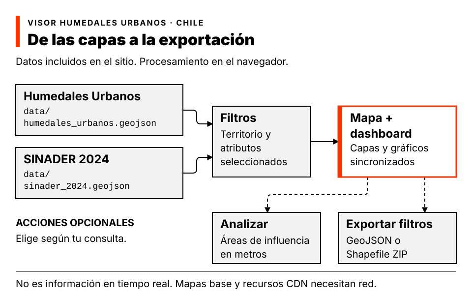

<h1 align="center">Visor Humedales Urbanos · Chile</h1>

<p align="center">
  <strong>Humedales, residuos y análisis territorial en un mismo mapa.</strong><br>
  Explora las capas, combina filtros y exporta resultados desde el navegador.
</p>

<p align="center">
  <a href="https://julloa.space/visor-humedales-chile/"><strong>Abrir el visor →</strong></a>
  · <a href="#inicio-rápido">Ejecutar en local</a>
  · <a href="#qué-puedes-hacer">Funcionalidades</a>
  · <a href="#datos-y-servicios-externos">Datos y fuentes</a>
</p>

<p align="center">
  <sub>Enlace alternativo: <a href="https://geoidegeoidal.github.io/visor-humedales-chile/">GitHub Pages</a></sub>
</p>

---

Visor geoespacial web para explorar los **Humedales Urbanos de Chile** junto con **SINADER 2024**, el registro de declaraciones de residuos de establecimientos. El procesamiento se realiza del lado del cliente: no requiere desplegar un backend propio ni configurar claves de API.

> **Alcance:** herramienta de visualización y análisis territorial. Las capas están versionadas como archivos estáticos; no son una consulta en tiempo real a las fuentes oficiales. Para decisiones oficiales, consulta siempre los organismos de origen.

## Qué puedes hacer

| Tarea | Herramientas |
| --- | --- |
| **Explorar** | Mapa MapLibre con bases clara y oscura, capas independientes y fichas de atributos. |
| **Filtrar** | Región, comuna y proceso para humedales; región y rubro para SINADER, con re-encuadre automático. |
| **Comparar** | Dashboard con tres gráficos Chart.js sincronizados con los filtros del mapa. |
| **Analizar** | Áreas de influencia en metros, individuales o disueltas, calculadas en un Web Worker. |
| **Exportar** | Subconjuntos filtrados en GeoJSON y Shapefile ZIP. |

### Capas disponibles

- **Humedales Urbanos:** polígonos con región, comuna, superficie, proceso de declaratoria y resolución.
- **SINADER 2024:** puntos de establecimientos generadores de residuos, con rubro, declaraciones y toneladas declaradas.

### De las capas a la exportación



Los archivos incluidos alimentan los filtros del mapa y del dashboard. Puedes calcular
áreas de influencia o exportar los subconjuntos filtrados; no necesitas realizar un análisis
antes de exportar. Las capas no se actualizan en tiempo real y los recursos externos siguen
necesitando conexión. [Fuente editable del diagrama](docs/readme/layer-workflow.html).

### Primer recorrido

1. Abre el visor y elige las capas que quieres consultar.
2. Aplica los filtros de cada capa y selecciona una entidad para leer sus atributos.
3. Consulta el dashboard o calcula un área de influencia.
4. Exporta el subconjunto filtrado para continuar el análisis en un SIG.

## Inicio rápido

La página carga los GeoJSON mediante `fetch`: **necesita un servidor HTTP local**; no basta con abrir `index.html` directamente.

Requisitos para esta opción: **Git**, **Python 3**, un navegador moderno y conexión a Internet para los recursos externos. No requiere npm ni un paso de compilación.

```sh
git clone https://github.com/geoidegeoidal/visor-humedales-chile.git
cd visor-humedales-chile
python -m http.server 8000 --bind 127.0.0.1
```

Abre [http://localhost:8000/](http://localhost:8000/). Si tu sistema usa `python3`, úsalo en lugar de `python` en la última línea. Detén el servidor con **Ctrl+C**.

## Datos y servicios externos

### Capas versionadas

| Capa | Archivo | Fuente |
| --- | --- | --- |
| Humedales Urbanos | [`data/humedales_urbanos.geojson`](data/humedales_urbanos.geojson) | Ministerio del Medio Ambiente de Chile, Sistema de Humedales Urbanos. |
| SINADER 2024 | [`data/sinader_2024.geojson`](data/sinader_2024.geojson) | Sistema Nacional de Declaración de Residuos, RETC / Ventanilla Única. |

Estas capas se leen desde el propio sitio. Una actualización de los organismos de origen no modifica automáticamente los archivos incluidos.

### Recursos que necesitan red

**Procesamiento en el navegador no significa funcionamiento completamente offline.** La aplicación también utiliza servicios externos:

- **Mapas base:** teselas de OpenStreetMap y Esri.
- **Interfaz y cartografía:** Tailwind CSS, MapLibre GL JS y fuentes de Google.
- **Gráficos, exportación y análisis:** Chart.js, `@mapbox/shp-write`, Turf.js y `polygon-clipping`, cargados desde CDN cuando se necesitan.

MapLibre y Tailwind se cargan al abrir la página; no todas las dependencias se cargan de forma diferida. Si un proveedor externo no está disponible, las funciones que dependen de él pueden verse afectadas. Las capas locales no eliminan estas dependencias de red.

## Tecnologías

| Componente | Tecnología |
| --- | --- |
| Mapa | [MapLibre GL JS](https://maplibre.org/) |
| Interfaz | HTML, JavaScript y [Tailwind CSS](https://tailwindcss.com/) |
| Dashboard | [Chart.js](https://www.chartjs.org/) |
| Áreas de influencia | [Turf.js](https://turfjs.org/), [polygon-clipping](https://github.com/mfogel/polygon-clipping) y Web Worker |
| Exportación Shapefile | [@mapbox/shp-write](https://github.com/mapbox/shp-write) |

## Estructura del proyecto

```text
index.html                        Interfaz y lógica de la aplicación
buffer-worker.js                  Áreas de influencia en segundo plano
data/humedales_urbanos.geojson     Capa de humedales urbanos
data/sinader_2024.geojson           Capa SINADER 2024
scripts/build-sinader-geojson.ps1   Conversión offline de Excel a GeoJSON
openspec/                         Especificaciones del proyecto
```

El script de conversión no es necesario para consultar el visor con los datos ya incluidos.
